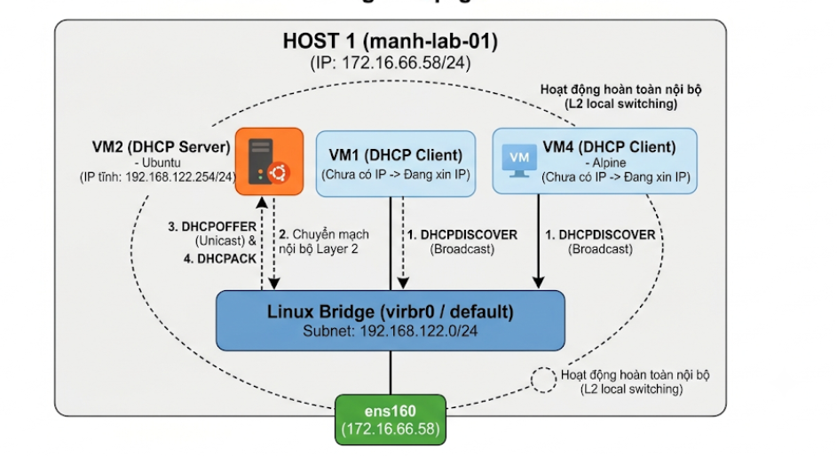
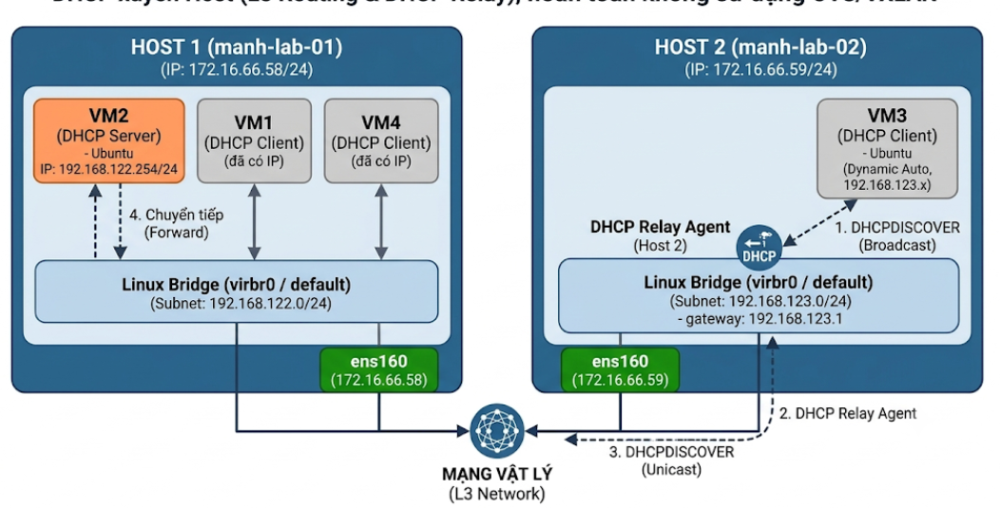

# Config DHCP cơ bản
## Mục tiêu bài Lab
Triển khai dịch vụ DHCP Server: Cài đặt và cấu hình dịch vụ DHCP (dnsmasq) trên vm2 (Ubuntu) để quản lý và cấp phát IP tự động.

Kiểm tra xin cấp IP nội bộ (Cùng Host 1): Kiểm tra các máy ảo client (vm1, vm4) xin và nhận IP tự động từ vm2 thông qua cầu nối mạng mặc định (virbr0) trên Host 1.

Kiểm tra xin cấp IP xuyên Host (Host 2 $\rightarrow$ Host 1): Kiểm tra máy ảo client (vm3) nằm ở Host 2 xin và nhận địa chỉ IP tự động từ DHCP Server vm2 nằm ở Host 1 thông qua hạ tầng mạng

## Kiến trúc & Thành phần hệ thống
Host
- Host 1 (manh-lab-01):Ubuntu - `172.16.66.58/24` - (VM1, 2, 4) 
- Host 2 (manh-lab-02): IP `172.16.66.59/24` - (VM3)

Phân vai các Máy ảo (VMs)

|Máy ảo|Vị trí Host|Hệ điều hành|Vai trò trong bài lab|Cấu hình IP|
|-|-|-|-|-|
|vm2|Host 1|Ubuntu|DHCP Server|IP Tĩnh|
|vm1|Host 1|Alpine|DHCP Client 1 (Cục bộ)|Nhận IP tự động từ vm2|
|vm4|Host 1|Alpine|DHCP Client 2 (Cục bộ)|Nhận IP tự động từ vm2|
|vm3|Host 2|Ubuntu|DHCP Client 3 (Từ xa)|Nhận IP tự động từ vm2|

## Mô hình Lab
Mô hình 1: Cấp phát IP nội bộ



Mô hình 2: Cấp phát IP khác dải



## Phần 1: Cấu hình DHCP nội bộ
### Tắt DHCP tự động trên Host.
Ví dụ tôi dùng KVM thì thực hiện như sau:
- Mở cấu hình mạng default
```
virsh net-edit default
```
- Xóa cụm `<dhcp>... </dhcp>`
- Khởi động lại mạng ảo
```
virsh net-destroy default
virsh net-start default
```
### Đặt IP tĩnh cho DHCP Server(VM2)
Truy cập VM2, xóa IP cũ và cấu hình IP tĩnh:
```
# Xóa IP cũ
sudo ip addr flush dev enp1s0

# Tạo IP mới
sudo ip addr add 192.168.122.254/24 dev enp1s0

# Bật card mạng
sudo ip link set dev enp1s0 up
```
Thiết lập Gateway mặc định
```
sudo ip route add default via 192.168.122.1 dev eth0
```
Kiểm tra thông số IP nhận được:
```
root@ubuntu:~# ip addr show enp1s0
2: enp1s0: <BROADCAST,MULTICAST,UP,LOWER_UP> mtu 1500 qdisc fq_codel state UP group default qlen 1000
    link/ether 52:54:00:76:ce:13 brd ff:ff:ff:ff:ff:ff
    inet 192.168.122.254/24 scope global enp1s0
       valid_lft forever preferred_lft forever
    inet6 fe80::5054:ff:fe76:ce13/64 scope link
       valid_lft forever preferred_lft forever
```
### Cài đặt và cấu hình DHCP Server
Cập nhận và cài đặt dnsmasq
```
sudo apt update && sudo apt install dnsmasq -y
```
Xóa file cũ và thêm mới file cấu hình
- Xóa file `rm -rf /etc/dnsmasq.conf`
- Tạo file cấu hình mới `vim /etc/dnsmasq.conf`
- Chèn vào nội dung sau:
```
# Chỉ lắng nghe yêu cầu trên card enp1s0
interface=enp1s0
bind-interfaces

# Dải IP cấp phát tự động (từ .10 đến .100), thời gian thuê 12 giờ
dhcp-range=192.168.122.10,192.168.122.100,255.255.255.0,12h

# Cung cấp Gateway mặc định (IP của host)
dhcp-option=option:router,192.168.122.1

# Cấp DNS cho Clients
dhcp-option=option:dns-server,8.8.8.8,1.1.1.1

# Bật tính năng ghi log phục vụ kiểm tra lỗi
log-dhcp
EOF'
```
Khởi động dịch vụ và kích hoạt tự động khởi chạy:
```
sudo systemctl restart dnsmasq
sudo systemctl enable dnsmasq
```
### Kiểm tra khả năng cấp phát IP
Truy cập vm1 kiểm tra:
```
ip addr flush dev eth0
ip link set eth0 up
udhcpc -i eth0
```
Kết quả nên có:
```
localhost:~# udhcpc -i eth0
udhcpc: started, v1.36.1
udhcpc: broadcasting discover
udhcpc: broadcasting discover
udhcpc: broadcasting select for 192.168.122.78, server 192.168.122.254
udhcpc: lease of 192.168.122.78 obtained from 192.168.122.254, lease time 43200
```
### Kiểm tra với tcpdump
```
root@ubuntu:~# tcpdump -i enp1s0 port 67 or port 68 -n
tcpdump: verbose output suppressed, use -v[v]... for full protocol decode
listening on enp1s0, link-type EN10MB (Ethernet), snapshot length 262144 bytes
08:23:52.243501 IP 0.0.0.0.68 > 255.255.255.255.67: BOOTP/DHCP, Request from 52:54:00:12:71:fe, length 300
08:23:55.302017 IP 0.0.0.0.68 > 255.255.255.255.67: BOOTP/DHCP, Request from 52:54:00:12:71:fe, length 300
08:23:55.305167 IP 192.168.122.254.67 > 192.168.122.78.68: BOOTP/DHCP, Reply, length 300
08:23:55.310750 IP 192.168.122.254.67 > 192.168.122.78.68: BOOTP/DHCP, Reply, length 300
08:23:55.390870 IP 0.0.0.0.68 > 255.255.255.255.67: BOOTP/DHCP, Request from 52:54:00:12:71:fe, length 300
08:23:55.424785 IP 192.168.122.254.67 > 192.168.122.78.68: BOOTP/DHCP, Reply, length 300
08:24:19.232844 IP 0.0.0.0.68 > 255.255.255.255.67: BOOTP/DHCP, Request from 52:54:00:76:ce:13, length 293
08:25:24.076752 IP 0.0.0.0.68 > 255.255.255.255.67: BOOTP/DHCP, Request from 52:54:00:76:ce:13, length 293
08:26:27.624600 IP 0.0.0.0.68 > 255.255.255.255.67: BOOTP/DHCP, Request from 52:54:00:76:ce:13, length 293
```
Phân tích chi tiết từng bước DORA trong log
- D - Discover (Khám phá):
  - Log: `08:23:52.243501 IP 0.0.0.0.68 > 255.255.255.255.67: BOOTP/DHCP, Request from 52:54:00:12:71:fe`
  - Diễn giải: Client mang địa chỉ nguồn `0.0.0.0:68` gửi tới đia chỉ đích `255.255.255.255:67`. Do chưa nhận phản hồi ngay lập tức, sau ~3 giây (08:23:55.302017), Client đã phát lại gói Discover thứ hai.
- O - Offer (Đề xuất):
  - Log: `08:23:55.305167 IP 192.168.122.254.67 > 192.168.122.78.68: BOOTP/DHCP, Reply`
  - Diễn giải: dnsmasq trên vm2 lắng nghe thấy gói Discover và đáp lại bằng một gói DHCPOFFER (hiển thị là Reply), ngỏ ý sẵn sàng cấp cho Client IP `192.168.122.78`.

- R - Request (Yêu cầu):
  - Log: `08:23:55.390870 IP 0.0.0.0.68 > 255.255.255.255.67: BOOTP/DHCP, Request from 52:54:00:12:71:fe`
  - Diễn giải: Client chấp nhận IP được đề xuất và gửi lại gói DHCPREQUEST Broadcast để xác nhận chọn Server `192.168.122.254`.

- A - Acknowledge (Xác nhận):
  - Log: `08:23:55.424785 IP 192.168.122.254.67 > 192.168.122.78.68: BOOTP/DHCP, Reply`
  - Diễn giải: Server vm2 phản hồi gói DHCPACK hoàn tất chu trình DORA. Client nhận gói này và gán chính thức địa chỉ `192.168.122.78` lên card mạng.

## Phần 2: Cấp phát IP khác Subnet
Nguyên lý hoạt động
- Host 1: Chứa VM2 (DHCP Server - `192.168.122.254/24`)

- Host 2: Chứa VM3 (DHCP Client) thuộc dải mạng mới `192.168.123.0/24`.

Gói Broadcast DHCPDISCOVER từ VM3 không thể vượt qua Router/Host 2 sang Host 1. Do đó, ta sẽ chạy DHCP Relay Agent trên Host 2 để hứng gói Broadcast từ VM3, đóng gói lại thành tin nhắn Unicast L3 và chuyển tiếp tới `192.168.122.254` trên Host 1.

### Cấu hình mạng default trên Host 2
- Xóa toàn bộ thẻ `<dhcp>...</dhcp>`
- Ở thẻ `<ip>..</ip>` thực hiện đổi từ `192.168.122.1` thành `192.168.123.1`. Mẫu trông như sau:

```
<network>
  <name>default</name>
  <uuid>bbb936d9-99a0-432b-a0c5-b583019f2843</uuid>
  <forward mode='nat'/>
  <bridge name='virbr0' stp='on' delay='0'/>
  <mac address='52:54:00:5a:06:e5'/>
  <ip address='192.168.123.1' netmask='255.255.255.0'>
  </ip>
</network>
```
- Khởi động lại bridge:
```
virsh net-destroy default
virsh net-start default
```
### Routing Host 1 và Host 2
Cả 2 Host cần biết đường đi tới Subnet của nhau để các gói tin Unicast giữa DHCP Relay và DHCP Server không bị đứt.

- Trên Host 2 (172.16.66.59):
```Bash
# Bật tính năng IP Forwarding
sysctl -w net.ipv4.ip_forward=1

# Thêm Route trỏ về Subnet của Host 1
ip route add 192.168.122.0/24 via 172.16.66.58
```
- Trên Host 1 (172.16.66.58):

```Bash
# Bật tính năng IP Forwarding
sysctl -w net.ipv4.ip_forward=1

# Thêm Route trỏ về Subnet của Host 2
ip route add 192.168.123.0/24 via 172.16.66.59
```
Quy tắc mặc định của Libvirt trong chain FORWARD sẽ từ chối (REJECT) các gói tin đi từ card mạng vật lý bên ngoài (ens160) vào bridge nội bộ virbr0, cần cho phép cho chuyển tiếp dữ liệu giữa card vật lý và bridge virbr0:
```
# Trên Host 1
iptables -I FORWARD -i ens160 -o virbr0 -j ACCEPT
iptables -I FORWARD -i virbr0 -o ens160 -j ACCEPT
```
### Thêm Pool IP cho Subnet mới vào dnsmasq trên DHCP Server
Truy cập `/etc/dnsmasq.conf` trên VM2 và thêm vào nội dung sau:
```
dhcp-range=set:host2,192.168.123.10,192.168.123.100,255.255.255.0,12h
dhcp-option=tag:host2,option:router,192.168.123.1
dhcp-option=tag:host2,option:dns-server,8.8.8.8
```
Khởi động lại dnsmasq:
```
systemctl restart dnsmasq
```
### Cài đặt và Chạy DHCP Relay Agent trên Host 2
Cài đặt gói dhcp-helper
```
apt update && apt install dhcp-helper -y
```
Khởi chạy `dhcp-helper` nghe trên interface virbr0 của Host 2 và chuyển tiếp tới IP Server `192.168.122.254`
```
dhcp-helper -i virbr0 -s 192.168.122.254
```
### Kiểm tra và xin IP
Truy cập vào vm3 làm mới lại mạng
```
networkctl renew enp1s0
ip addr flush dev enp1s0
systemctl restart systemd-networkd
netplan apply
```
Kết quả:
```
2: enp1s0: <BROADCAST,MULTICAST,UP,LOWER_UP> mtu 1500 qdisc fq_codel state UP group default qlen 1000
    link/ether 52:54:00:44:5e:ec brd ff:ff:ff:ff:ff:ff
    inet 192.168.123.57/24 metric 100 brd 192.168.123.255 scope global dynamic enp1s0
       valid_lft 43024sec preferred_lft 43024sec
    inet6 fe80::5054:ff:fe44:5eec/64 scope link
       valid_lft forever preferred_lft forever
```
### Đứng ở VM2 bắt gói tin
Sử dụng tcpdump
```
tcpdump -i enp1s0 port 67 or port 68 -n -v
```
Kiểm tra
```
09:22:48.027205 IP (tos 0xc0, ttl 64, id 0, offset 0, flags [none], proto UDP (17), length 321)
    0.0.0.0.68 > 255.255.255.255.67: BOOTP/DHCP, Request from 52:54:00:76:ce:13, length 293, xid 0x4fcc3f76, secs 1214, Flags [none]
          Client-Ethernet-Address 52:54:00:76:ce:13
          Vendor-rfc1048 Extensions
            Magic Cookie 0x63825363
            DHCP-Message (53), length 1: Discover
            Client-ID (61), length 19: hardware-type 255, 56:50:4d:98:00:02:00:00:ab:11:25:5d:4b:4b:1f:92:51:4a
            Parameter-Request (55), length 12:
              Subnet-Mask (1), Default-Gateway (3), Domain-Name-Server (6), Hostname (12)
              Domain-Name (15), MTU (26), Static-Route (33), NTP (42)
              URL (114), Unknown (119), Unknown (120), Classless-Static-Route (121)
            MSZ (57), length 2: 1472
            SLP-NA (80), length 0""
            Hostname (12), length 6: "ubuntu"

09:22:59.625185 IP (tos 0x0, ttl 63, id 63796, offset 0, flags [none], proto UDP (17), length 321)
    172.16.66.59.67 > 192.168.122.254.67: BOOTP/DHCP, Request from 52:54:00:44:5e:ec, length 293, hops 1, xid 0x2f5d2f99, secs 1, Flags [none]
          Gateway-IP 192.168.123.1
          Client-Ethernet-Address 52:54:00:44:5e:ec
          Vendor-rfc1048 Extensions
            Magic Cookie 0x63825363
            DHCP-Message (53), length 1: Discover

09:23:02.646005 IP (tos 0xc0, ttl 64, id 33924, offset 0, flags [none], proto UDP (17), length 328)
    192.168.122.254.67 > 192.168.123.1.67: BOOTP/DHCP, Reply, length 300, hops 1, xid 0x2f5d2f99, secs 1, Flags [none]
          Your-IP 192.168.123.57
          Server-IP 192.168.122.254
          Gateway-IP 192.168.123.1
          Client-Ethernet-Address 52:54:00:44:5e:ec
          Vendor-rfc1048 Extensions
            Magic Cookie 0x63825363
            DHCP-Message (53), length 1: Offer

09:23:02.650174 IP (tos 0x0, ttl 63, id 64950, offset 0, flags [none], proto UDP (17), length 331)
    172.16.66.59.67 > 192.168.122.254.67: BOOTP/DHCP, Request from 52:54:00:44:5e:ec, length 303, hops 1, xid 0x2f5d2f99, secs 3, Flags [none]
          Gateway-IP 192.168.123.1
          Client-Ethernet-Address 52:54:00:44:5e:ec
          Vendor-rfc1048 Extensions
            Magic Cookie 0x63825363
            DHCP-Message (53), length 1: Request


09:23:02.670893 IP (tos 0xc0, ttl 64, id 33929, offset 0, flags [none], proto UDP (17), length 328)
    192.168.122.254.67 > 192.168.123.1.67: BOOTP/DHCP, Reply, length 300, hops 1, xid 0x2f5d2f99, secs 3, Flags [none]
          Your-IP 192.168.123.57
          Server-IP 192.168.122.254
          Gateway-IP 192.168.123.1
          Client-Ethernet-Address 52:54:00:44:5e:ec
          Vendor-rfc1048 Extensions
            Magic Cookie 0x63825363
            DHCP-Message (53), length 1: ACK

```
D - Discover (09:22:59): Client (VM3 - MAC 52:54:00:44:5e:ec) gửi gói Broadcast. Relay Agent trên Host 2 (172.16.66.59) nhận gói, chèn địa chỉ Gateway-IP `192.168.123.1` và Unicast sang DHCP Server (`192.168.122.254`).

O - Offer (09:23:02.646): DHCP Server nhận diện yêu cầu thuộc dải mạng `192.168.123.0/24` (nhờ thông tin Gateway-IP), gửi lại gói Unicast đề xuất cấp địa chỉ IP `192.168.123.57`.

R - Request (09:23:02.650): Client chấp nhận đề xuất; Relay Agent chuyển tiếp gói xác nhận đồng ý thuê IP `192.168.123.57` về Server.

A - ACK (09:23:02.670): Server chốt hợp đồng thuê (Lease time 12 giờ), gửi phản hồi hoàn tất kèm đầy đủ các tham số: Default Gateway (`192.168.123.1`) và DNS (8.8.8.8).