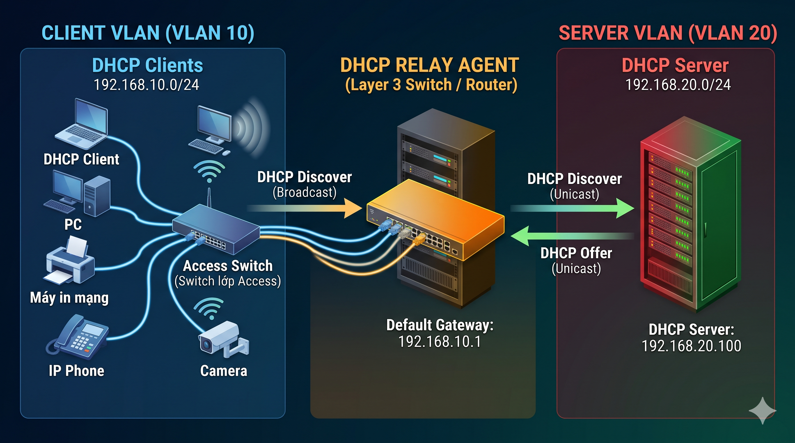
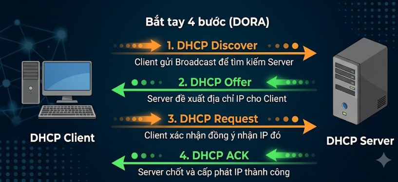

# Mục này tìm hiểu về DHCP
## Một số thuật ngữ
Quản lý dải IP & Cấu hình:
- Scope / Superscope: Scope là dải IP cấp cho 1 Subnet; Superscope gộp nhiều Scope để quản lý trên cùng một mạng vật lý.
- Exclusion Range / Reservation: Exclusion Range (dải IP loại trừ không cấp động); Reservation (gán IP cố định theo địa chỉ MAC).
- GIADDR (Gateway IP Address): Địa chỉ IP của Relay Agent chèn vào gói tin để DHCP Server biết Client thuộc Subnet nào.

Thời gian thuê & Gia hạn (Lease Timers):
- Lease Time: Tổng thời gian Client được phép dùng IP.
- T1 Timer (50% Lease): Client gửi Unicast cho Server cũ để xin gia hạn.
- T2 Timer (87.5% Lease): Nếu T1 thất bại, Client gửi Broadcast tìm bất kỳ Server nào để xin gia hạn.

Tùy chọn bổ sung & Dự phòng:
- DHCP Options: Các thông số cấp kèm IP (Option 3: Default Gateway, Option 6: DNS Server, Option 82: Vị trí cổng/VLAN của Client).
- DHCP Failover / Split Scope: Các giải pháp dự phòng (Failover đồng bộ trạng thái 2 Server; Split Scope chia dải IP 80/20).

Bảo mật & Trạng thái lỗi:
- APIPA: Dải IP tự gán (169.254.x.x) khi Client không nhận được phản hồi từ DHCP Server.
- DHCP Snooping / Rogue Server: Tính năng trên Switch lọc gói tin để chặn máy chủ DHCP giả mạo (Rogue Server).
## Khái niệm
DHCP - Dynamic Host Configuration Protocol là 1 giao thức cấu hình tự động cho host
## Dùng để làm gì?
Nhiều người hay nghĩ đơn giản rằng DHCP sử dụng để cấp phát IP tự động. Đúng mà chưa đủ:
- Cung cấp cho các host địa chỉ IP, Subnet Mask, default Gateway
- Cung cấp 1 database trung tâm để theo dõi tất cả các máy tính trong hệ thống mạng
- Ngoài việc cung cấp địa chỉ IP, DHCP còn cung cấp các thông tin cấu hình khác, cụ thể là DNS

Mục đích: Tránh trường hợp 2 máy trong cùng 1 mạng có cùng 1 địa chỉ IP
- 
## Hoạt động ở đâu
DHCP sử dụng giao thức UDP để giaot tiếp, hoạt động ở tầng Applications. Sử dụng 2 Port là 67 và 68. Trong đó
- Port 67 dùng để lắng nghe các yêu cầu từ client
- Port 68 dùng để trả lời

## Ưu điểm và nhược điểm
Ưu điểm:
- Tập trung quản trị thông tin cấu hình host
- Cấu hình động các máy
- Cấu hình IP cho các máy một cách liền mạch
- Sự linh hoạt
- Đơn giản hóa vài trò quản trị của việc cấu hình địa chỉ IP của client.
- Sự linh hoạt

Nhược điểm:
- Không phù hợp khi cần gán IP cố định cho thiết bị: Các thiết bị như máy chủ (Web Server, Database Server), máy in mạng, hoặc các thiết bị mạng cốt lõi cần địa chỉ IP cố định để các thiết bị khác luôn tìm thấy chúng
- Quá trình cấp phát IP chủ yếu sử dụng các gói tin Broadcast. Trong các mạng quy mô lớn, lượng lớn gói tin DHCP Broadcast có thể làm giảm hiệu suất mạng hoặc gây ra bão Broadcast
- Khó khăn trong việc truy vết và giám sát do IP có thể bị thay đổi
- Nếu máy chủ DHCP duy nhất trong mạng gặp sự cố và không có cơ chế dự phòng, toàn bộ các thiết bị mới kết nối hoặc các thiết bị hết hạn thuê sẽ không thể lấy được IP để truy cập mạng.

## Kiến trúc thành phần
Kiến trúc DHCP thì bao gồm 3 thành phần:

### DHCP Server (Máy chủ cấp phát IP)
Vị trí trong sơ đồ mạng: Đặt ở khu vực máy chủ tập trung (Server Zone / Data Center) thuộc phân vùng VLAN riêng (VLAN Server). Trong mạng doanh nghiệp lớn, DHCP Server được quản lý tập trung tại một nơi để dễ kiểm soát toàn bộ quỹ IP. Trong mạng nhỏ, nó được tích hợp sẵn trên thiết bị Gateway chính.

Ví dụ thiết bị:
- Máy chủ chuyên dụng (Server): Dell PowerEdge hoặc HP ProLiant chạy hệ điều hành Windows Server (bật dịch vụ DHCP Server) hoặc Linux Server (chạy isc-dhcp-server, kea-dhcp).
- Router / Firewall: Cisco ISR, MikroTik Cloud Core Router, FortiGate Firewall.
- Modem / Wi-Fi Router gia đình: TP-Link, Asus, Modem GPON Viettel/VNPT/FPT.

### DHCP Client (Thiết bị xin cấp IP)
Vị trí trong sơ đồ mạng: Đặt ở tầng truy cập (Access Layer), kết nối trực tiếp vào các cổng Access trên Switch hoặc phát sóng Wi-Fi từ Access Point (AP). Thiết bị nằm ở các phân đoạn mạng end-user (VLAN User, VLAN Guest, VLAN IoT,...).

Ví dụ thiết bị:
- Thiết bị cá nhân: Laptop (Windows/macOS), Điện thoại thông minh (iPhone, Android), Máy tính bảng.
- Thiết bị văn phòng: Máy in mạng, IP Phone, Máy chấm công.
- Thiết bị IoT / Đồ gia dụng: Smart TV, Camera IP, Robot hút bụi, Công tắc thông minh.

### DHCP Relay Agent (Thiết bị trung chuyển)
Vị trí trong sơ đồ mạng: Đặt ngay tại Default Gateway của phân đoạn mạng chứa DHCP Client. Nhờ vị trí này, nó có thể tiếp nhận trực tiếp gói tin Broadcast xin IP từ Client thuộc VLAN đó, đóng gói lại thành Unicast và chuyển sang VLAN của DHCP Server.

Ví dụ thiết bị:
- Switch Layer 3: Cisco Catalyst (9200, 9300), Aruba CX Switch, Switch HP/Huawei (cấu hình ip helper-address hoặc dhcp select relay trên SVI - Switched Virtual Interface).
- Router trung tâm: Cisco ISR 4000 series, Juniper MX series, MikroTik RouterBOARD.
- Firewall doanh nghiệp: FortiGate, Palo Alto Networks (khi Firewall làm Gateway cho các VLAN nội bộ).

## Hoạt động như thế nào
Trường hợp môi trường mạng nhỏ

Trường hợp môi trường mạng lớn(khác VLAN)

Trường hợp 1: Cùng Subnet / VLAN (Không có Relay Agent)
- Cơ chế: Client và DHCP Server giao tiếp trực tiếp với nhau trong cùng một mạng nội bộ.
- Luồng xử lý: Client phát tin Broadcast (Discover) ra toàn mạng $\rightarrow$ Server nhận trực tiếp và gửi Offer $\rightarrow$ Client phản hồi Request $\rightarrow$ Server chốt cấp IP bằng ACK.
- Áp dụng: Mạng gia đình, văn phòng nhỏ, hoặc mô hình 1 phân đoạn mạng duy nhất.

Trường hợp 2: Khác Subnet / VLAN (Có DHCP Relay Agent)
- Cơ chế: Client và DHCP Server ở hai mạng khác nhau. Relay Agent (Router/Switch Layer 3) đứng ở giữa làm nhiệm vụ chuyển tiếp gói tin qua lại giữa 2 Subnet.
- Luồng xử lý: Client phát tin Broadcast (Discover) $\rightarrow$ Relay Agent chặn lại, đính kèm IP cổng của mình (GIADDR) rồi đổi thành Unicast gửi tới Server $\rightarrow$ Server đọc GIADDR để chọn đúng dải IP và phản hồi Unicast về Relay Agent $\rightarrow$ Relay Agent phát lại cho Client (các bước Request/ACK diễn ra tương tự).
- Áp dụng: Mạng doanh nghiệp chia nhiều VLAN, quản lý tập trung một DHCP Server duy nhất.